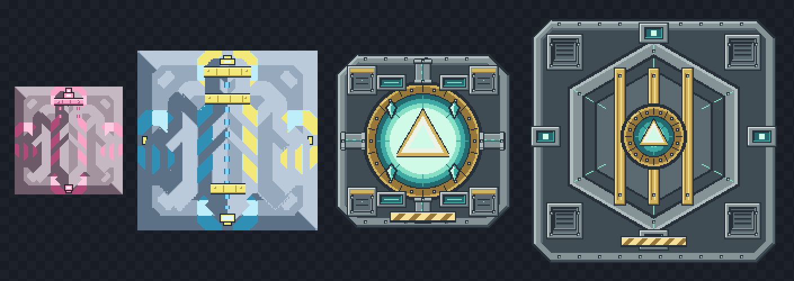
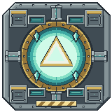
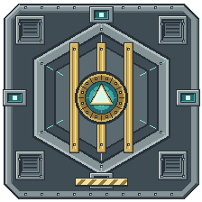

# More Utils

**More space for your factory. More reach for your logistics.** More Utils adds upgraded mass drivers and a late-game storage network built around the Bayugo Crystal.

## Added content

- **Thorium Mass Driver (3×3)** — a reinforced, long-range driver with a 180-item capacity and a distinctive pink firing effect.
- **Surge Mass Driver (5×5)** — a high-capacity driver that carries 520 items over extreme distances, with cyan-and-yellow firing effects.
- **Bayugo Crystal** — a synthetic late-game material produced by combining refined solids with slag and cryofluid.
- **B.B Collider (5×5)** — needs 12 silicon, 8 thorium, 8 blast compound, 6/s slag, 6/s cryofluid and 24 power, producing one Bayugo Crystal every 8 seconds.
- **Core Link (7×7)** — a remote access point for your team's core inventory. Conveyors can feed items into it, and adjacent unloaders can withdraw from the same core stockpile. It adds **no extra storage capacity** and requires an active core.

## Sprites

Both buildings are drawn from scratch with the same pixel vocabulary as the vanilla-derived mass drivers: hard 1px outlines, 2px bevels, chunky armour plates, rivets, vents, hazard stripes and pipe flanges, over a narrow 14-colour grey-steel palette. The 20% sci-fi layer is an Iron-Man-style arc reactor — segmented gold rings, teal containment rings, a white-hot core and Bayugo crystal inlays.

Run `py -3 tools/generate_buildings.py` to regenerate every candidate and its contact sheet into `docs/designs/`.

### Selected designs

| Building | Design |
|---|---|
| B.B Collider | **A — Torus Reactor** |
| Core Link | **B — Hex Vault** |

All five candidates for each building remain in `docs/designs/` for reference. `CHOSEN` in `tools/generate_buildings.py` controls which design is installed into `sprites/`, so the shipped art is reproducible in one command.

## Effects

- **B.B Collider** — on every craft: a mint shockwave, a delayed gold shockwave, radial mint and gold sparks, and a puff of grey vent smoke. While running it emits a slow trickle of mint motes, and its warmup ramps down gently instead of snapping off.
- **Core Link** — a mint/gold placement flash and spark ring, a small spark burst on deconstruction, and a large mint-and-gold shockwave plus sparks and smoke on destruction. At runtime it also pulses its arc reactor every few seconds and throws a short spark whenever stock moves through the terminal.

## Core Link balancing

Core Link is intentionally expensive so each placement is a strategic logistics decision rather than a block to spam. Each one requires 40 Bayugo Crystals, surge alloy, phase fabric, thorium, and other late-game materials. Core Link follows the core's item capacity and availability; it does not create a separate inventory. Its runtime adapter is installed after JSON content loading, using the core's item module directly. Withdrawals are handled by vanilla unloaders.

## Requirements

- **Mindustry v8**, build **160 or newer**.
- Compatible with desktop and mobile versions that support Mindustry JavaScript mod scripts.

## Installation

Download the mod from the [GitHub repository](https://github.com/Skhallops/More-Utils) and import its ZIP through **Mods → Import Mod** in Mindustry. Alternatively, place the extracted mod folder in your Mindustry `mods` directory.

## What's next

More Utils will continue to expand with additional useful blocks and quality-of-life improvements in future updates.

## Credits

Mindustry is created by [Anuken](https://github.com/Anuken/Mindustry) and its contributors. The mass-driver sprites are derived from Mindustry's vanilla assets and distributed under the [GPL-3.0 license](LICENSE). The Bayugo Crystal, B.B Collider, and Core Link sprites are original pixel-art assets created for this mod.
